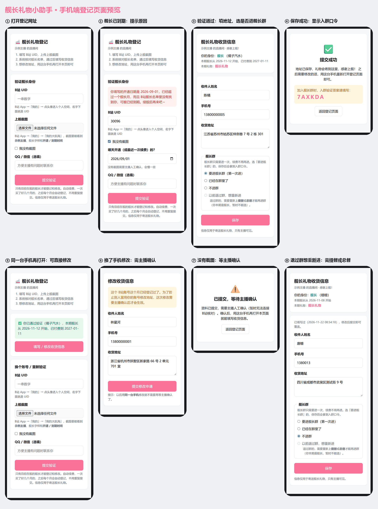

# 🚢 B站舰长礼物小助手

> 给 B站主播用的桌面小软件：**舰长自己打开网页登记，系统自动核对是不是在舰的舰长，收集收货地址和手机号**，月底点一下就导出 Excel 发货表。
>
> 下载、解压、双击就能用，**不用装 Python，不用写代码，不用改配置文件，也不需要 QQ 机器人**。

---

## 它能帮你做什么？

以前：观众上舰 → 你一个个看截图 → 一个个私聊要地址 → 抄到表格里……很累，还容易漏。

现在：

| 以前你要做的 | 现在谁来做 |
|---|---|
| 看截图确认是不是舰长 | 🌐 观众在登记网页上传截图，软件自动识别，并去 B站 核对舰长名单 |
| 记下每个人哪天上的舰 | 🌐 自动从截图里读出日期并记录 |
| 私聊要地址、手机号 | 🌐 验证通过后观众自己填 |
| 舰长说“我搬家了要改地址” | 🌐 同一台手机再打开网页就能改；换了手机改要你点一下确认（防止别人冒充） |
| 自动续费 / 一次买了好几个月的，每个月都要再登记一遍 | 🔄 **自动续登**：上一期结束后还在舰长名单里，就自动记入下个月的发货表，地址沿用 |
| 整理发货名单 | 🖥️ 在软件里点「导出 Excel 发货表」 |

你只需要偶尔点一下「通过」（软件拿不准的人会交给你确认），然后照着表格寄礼物。

---

## 舰长那边看到的是什么样？

舰长用手机打开你发的网址（或扫二维码）：

1. 填 **B站 UID**，上传**上舰截图**（要能看到主播名和开通 / 到期时间）
2. 软件识别截图、核对你直播间的舰长名单 → ✅ 通过
3. 填写 **收件人、手机号、收货地址** → 完成，还会看到一个**入群口令**（加舰长群时可以用）
4. 想修改：**用同一台手机再打开网址**就能直接改

> 只有**目前在舰**的舰长才能登记和修改。**自动续费、一次买了好几个月**的舰长只需要登记一次，之后每个月会自动登记。
> 没有截图也可以填开通日期提交，由你人工确认。

**手机上实际看到的页面**（点图片可以放大）：



### 自动续费、一次买好几个月的怎么算？

**每个“舰长月”寄一份礼物**（舰长月按 30 天算）：

| 情况 | 软件怎么处理 |
|---|---|
| 11 月 3 日上了 1 个月 | 记入 **11 月**发货表 |
| 每月自动续费 | 第一次登记后，每次续上（上一期结束后还在 B站舰长名单里）就**自动记入新月份**的发货表，地址沿用 |
| 9 月 15 日一次买了 3 个月 | 9、10、11 月各一份。截图里有到期时间的话，软件知道他付费到 12 月 14 日，每个月**自动登记**；中途才来登记也能通过 |
| 上个月上的、这个月才来登记（还在舰期内） | 记入**本月**发货表（补登记） |
| 舰长已经到期没续 | 不能登记，网页会提示到期时间 |

**提督、总督自带下级礼物**：

| 等级 | 每个月寄 |
|---|---|
| 舰长 | 舰长礼物 |
| 提督 | 提督礼物 + 舰长礼物 |
| 总督 | 总督礼物 + 提督礼物 + 舰长礼物 |

- **舰长中途升级提督**：软件发现他在 B站名单里变成提督后，会把这个月那一份直接升级为「提督礼物 + 舰长礼物」（合并成一份）。
  如果那份舰长礼物已经标记发货，就另记一条只补寄「提督礼物」。
- **提督到期后接上的舰长时间不另算**：B站会把升级前没用完的舰长时间暂停、等提督到期后接着算，这段时间已经包含在提督自带的舰长礼物里，不会再自动登记。
  这段时间用完后他自己又续了舰长，才算新的一份。
- 「舰长管理」的「礼物」一栏会写清楚每个人要寄什么，右上角显示这个月**每种礼物要准备几份**；导出的 Excel 里有「应寄礼物」一列和「礼物汇总」表。

> 自动续登后几天内，如果发现他其实已经不在舰长名单了（没续费），这条记录会**自动撤销**，不会多寄。
> 在「舰长管理」里，自动生成的记录状态显示为「自动续登」；不想用这个功能，可以在「设置」里关掉。

---

## 软件长什么样？

左边 5 个页面：

| 页面 | 能做什么 |
|---|---|
| 🏠 **运行状态** | 一键启动服务；**登记网址一键复制 / 生成二维码**；看 B站舰长人数、本月已验证 / 待审核 / 没填地址人数、待确认的地址修改 |
| 🚢 **舰长管理** | 一张表看所有舰长和地址；「通过 / 拒绝 / 标记已发货 / 编辑地址 / 查看截图」；处理地址修改申请；导出 Excel |
| 📊 **查询对比** | **导入以前几个月的表格**；在所有月份里查人；两个月对比（新上舰 / 没续 / 连续在舰）；地址、手机号变化；和 B站舰长名单对比；收件信息检查 |
| ⚙ **设置** | 填直播间号点「检测」自动填好主播信息；填观众访问地址；可以改登记页让舰长留的联系方式（如「QQ 号」「微信号」），并设为必填或选填 |
| ❓ **使用帮助** | 详细步骤；一键复制群公告 |

有人等你审核时，「舰长管理」旁边会出现 🔴 红点，任务栏图标也会闪。

---

## 开始之前，你需要准备

- ✅ 一台 **Windows 10 / 11 电脑**
- ✅ 你的 **B站直播间号**（直播间网址 `live.bilibili.com/` 后面那串数字）
- ✅ 一个让观众能用手机打开网页的办法：**内网穿透**（免费、简单）或**云服务器**（见第 3 步）
- ✅ 大约 **20 分钟**

---

## 安装步骤（第一次用跟着做）

### 第 1 步：下载软件

1. 打开 👉 **[下载页面](https://github.com/KaCarl19/bilibili-guard-gift/releases/latest)**，在 Assets 里点 **`guard-gift-windows.zip`** 下载
2. 右键压缩包 → **全部解压缩**，放到一个好找的地方（比如桌面）。⚠️ 不要在压缩包里直接双击运行
3. 打开解压出来的文件夹，双击 **`舰长礼物小助手.exe`**

> 💡 如果弹出蓝色窗口「Windows 已保护你的电脑」：点 **更多信息** → **仍要运行**。
> （这是因为软件没有花钱买数字签名证书，不是病毒。）

### 第 2 步：填写你的直播间

第一次打开，软件会自动跳到 **⚙ 设置** 页：

1. **直播间号**：填你的直播间号，点粉色的 **「检测直播间」** 按钮
   → 会显示「✅ 找到直播间：主播「xxx」，当前舰长 N 人」，主播昵称和截图关键词会自动填好
2. 拉到最下面，点 **「💾 保存设置」**

### 第 3 步：让观众能用手机打开登记网页

软件的登记网页默认地址是 `http://127.0.0.1:8765`，**只有你这台电脑能打开**。要让观众用手机打开，任选一种：

| 办法 | 适合谁 | 怎么做 |
|---|---|---|
| **内网穿透**（简单） | 先用起来 | 注册并安装 [cpolar](https://www.cpolar.com/) 之类的内网穿透工具，新建一个 HTTP 隧道指向本机端口 **8765**，它会给你一个公网网址。把这个网址填到软件「设置 → 观众访问地址」，保存。<br>缺点：电脑关机或软件关闭时观众打不开；免费版的网址可能会变，变了要重新填、重新发二维码 |
| **云服务器**（长期推荐） | 想 24 小时在线 | 租一台 Windows 云服务器，把软件放上去运行，在服务器的安全组里开放 **8765** 端口，「观众访问地址」填 `http://服务器IP:8765` |

### 第 4 步：启动，把网址发给舰长们

1. 回到 **🏠 运行状态**，点 **「启动服务」**，等几秒显示 **● 运行中**
2. 「🌐 观众登记网页」显示 **● 已开放** 就说明观众能打开了（显示「仅本机」说明第 3 步还没做好）
3. 点 **「二维码」** 保存图片，或者在「❓ 使用帮助」点 **「复制群公告」**
4. 发到 **舰长群公告、B站动态、直播间公告、粉丝群** 都可以

> 以后每次打开软件会**自动启动服务**（可以在设置里关掉）。
> ⚠️ 服务运行时**不要关闭软件窗口**，关了观众就打不开登记网页了（可以最小化）。

### 第 5 步：试一试

用自己的手机打开登记网址，能看到「🚢 舰长礼物登记」页面就成功了 🎉

---

## 日常怎么用？

| 什么时候 | 怎么做 |
|---|---|
| 每次开电脑 | 打开本软件（会自动启动服务）；用内网穿透的话把穿透工具也打开 |
| 看到 🔴 红点 / 任务栏闪烁 | 「🚢 舰长管理」→ 选中「待审核」那一行 →「🖼 查看截图」→ 没问题点「✔ 通过」。观众刷新登记页面就能填地址 |
| 看到「📝 地址修改申请」 | 观众换了手机改地址时需要你确认：点「📝 修改申请」，对照原地址核对后点「同意修改」 |
| 观众私信你新地址 | 「🚢 舰长管理」里**双击**他那一行，直接帮他改 |
| 准备寄礼物了 | 「🚢 舰长管理」选好月份 →「导出 Excel 发货表」 |
| 寄之前检查一遍 | 「📊 查询对比」→「✅ 信息检查」看有没有缺地址、手机号写错的；「📡 和 B站名单对比」看谁在舰但还没登记 |
| 寄完了 | 选中这些人（按住 Ctrl 可多选）→「📦 标记已发货」（会记下这一份寄到的地址，以后能查） |

### 以前几个月的表格怎么办？

在「📊 查询对比」点 **「📥 导入以前的表格」**，选你以前收集的 Excel（.xlsx）或 CSV：

- 本软件导出的表格、你自己做的表格都可以。软件会自动认出「昵称」「UID」「收件人」「手机号」「地址」「省 / 市 / 区」「已发货」这些列，**认错了可以在下拉框里改**
- 一个文件里每个月一张工作表（比如「9月」「10月」）也可以，月份会按工作表名自动填好，不对可以改
- 导入前会先列出每一行怎么处理（新增 / 已有跳过 / 无法导入及原因），确认后才写入
- 导入的记录算作那个月的舰长记录（已发货），在「舰长管理」里也能看到；以后这位舰长来登记时，会沿用表格里最新的地址
- 同一个文件导入两次不会重复

导入后就可以：

| 功能 | 用来做什么 |
|---|---|
| 🔍 查询 | 输入昵称 / UID / 手机号 / 地址关键字，查到他哪几个月上过舰、每次寄到了哪里 |
| 📅 两个月对比 | 列出新上舰的、没续的、连续在舰的，以及等级和收件信息的变化 |
| 🏠 地址 / 手机号变化 | 同一个人不同月份留的收件信息不一样时列出来，避免寄到旧地址 |
| 📡 和 B站名单对比 | 谁在舰但这个月还没登记、谁登记了但已不在名单、等级对不上的 |
| ✅ 信息检查 | 缺地址、手机号格式不对、地址不完整、多人共用手机号、同一人重复登记 |

每个结果都可以「导出这张表」成 Excel；双击一行可以直接修改收货信息。

### 管理舰长群（可选）

观众登记成功后会看到一个 6 位的**入群口令**。可以把 QQ 群设置成「需要回答问题才能加入」，让观众填这个口令；你在「舰长管理」的搜索框里输入口令，就能核对他是不是已验证的在舰舰长。

---

## QQ 机器人（可选，高级）

**收集地址完全不需要 QQ 机器人。** 如果你还想让机器人在群里自动识别截图、私聊处理改地址、自动通知审核结果，可以启用：

1. 准备一个 **QQ 小号**，安装 QQ 协议端 **[LLBot](https://luckylilliadoc.pages.dev/)** 并登录小号
   （NapCat 已停止维护，不再推荐；两者接入方式一样，都支持 OneBot 11）
2. 在协议端里开启 OneBot 11 的**反向 WebSocket**，地址填软件「运行状态」页「复制连接地址」得到的网址
   （一般是 `ws://127.0.0.1:8765/onebot/v11/ws`）
3. 软件「⚙ 设置」勾选 **「启用 QQ 机器人」**，填舰长群群号和你的 QQ，保存并重启服务
4. 「💬 QQ 机器人」显示 **● 已连接** 即可

> ⚠️ LLBot、NapCat 这类工具都不是腾讯官方的，**有被 QQ 风控、掉线、封号的风险**，一定要用小号，不要用大号。
> 就算机器人用不了，登记网页也照常工作。

---

## 常见问题

<details>
<summary><b>❓ 双击 exe 没反应 / 提示缺少文件</b></summary>

- 确认已经**解压**了整个压缩包，而不是在压缩包里直接双击
- `舰长礼物小助手.exe` 旁边的 `_internal` 文件夹不能删、不能挪走
- 被杀毒软件拦了：把软件文件夹加入杀毒软件的信任/白名单（打包工具生成的程序偶尔会被误报）
</details>

<details>
<summary><b>❓ 观众打不开登记网页</b></summary>

- 「运行状态」页的「🌐 观众登记网页」显示**仅本机**：还没设置「观众访问地址」，看上面第 3 步
- 用内网穿透的：确认穿透工具开着、隧道指向的端口和软件设置里的端口一样（默认 8765）
- 用云服务器的：确认安全组 / 防火墙开放了端口
- 软件窗口要一直开着，「后台服务」显示 **● 运行中**
</details>

<details>
<summary><b>❓ 提示「端口 8765 被占用」</b></summary>

到「设置」把**端口**改成别的数字（比如 8766），保存。内网穿透的隧道端口也要改成一样的。
</details>

<details>
<summary><b>❓ 截图总是识别失败</b></summary>

- 让观众上传**完整、清晰**的原图，不要裁剪、不要拍屏幕
- 检查「设置 → 截图关键词」，截图上的主播名要和这里填的一模一样
- 识别不了也没关系：观众可以勾选「我没有截图」填日期，由你人工确认；你也可以在「舰长管理」点「＋ 手动添加」
</details>

<details>
<summary><b>❓ 有人冒充舰长、或者想改别人的地址怎么办？</b></summary>

软件已经做了这些防护：
- 会去 B站 核对真实的舰长名单，不在名单里的一律交给你人工审核
- 同一张截图不能被重复使用
- 一个 B站账号登记过之后，**只有同一台手机能直接修改**；换手机修改要你确认，原地址不会被直接改掉
- 没有截图的一律交给你人工审核，不会自动通过
- 同一个网络频繁提交会被限制
</details>

---

## 🔒 隐私提醒（很重要）

舰长的手机号和地址是**个人隐私**，请务必：

- 所有数据都在软件文件夹里的 **`data`** 文件夹中（「运行状态」页点「打开数据文件夹」）：**定期备份**，但**不要发给别人、不要上传到网上**
- 「设置」里的网页后台密码不要告诉别人
- 礼物寄完后，可以考虑定期清理很久以前的地址
- 如果你 fork / 修改了这个项目并上传到 GitHub，**不要上传 `config.yaml` 和 `data` 文件夹**（本项目的 `.gitignore` 已经默认排除了它们）

---

## 想了解更多？

完整的判断流程、所有设置项说明，请看 👉 [使用说明.md](使用说明.md)

<details>
<summary>给开发者：从源码运行 / 打包 / 技术栈</summary>

```bash
python -m venv .venv
.venv\Scripts\pip install -r requirements.txt
.venv\Scripts\python main.py          # 打开图形界面
.venv\Scripts\python bot.py           # 只运行服务（无界面，适合 Linux 服务器）
```

打包成 exe（产物在 `dist/`，同时生成 zip）：
```bash
.venv\Scripts\pip install pyinstaller pillow
.venv\Scripts\python build_exe.py
```

- 界面：PySide6（Qt 6）。后台服务在子进程运行（同一个程序加 `--bot` 参数），界面通过本机接口查看状态
- 观众登记网页：FastAPI + Jinja2；网页登记的身份标识为 `web:B站UID`，用 Cookie 记住设备
- QQ 机器人（可选）：[NoneBot2](https://nonebot.dev/) + OneBot V11，接 LLBot / NapCat 等协议端（反向 WebSocket）
- 截图识别：[RapidOCR](https://github.com/RapidAI/RapidOCR)（本地离线识别，不上传图片）
- 舰长名单：B站直播公开接口 `guardTab/topList`（无需登录）
- 数据：SQLite（`data/guard.db`），配置：`config.yaml`（界面里修改）
</details>
